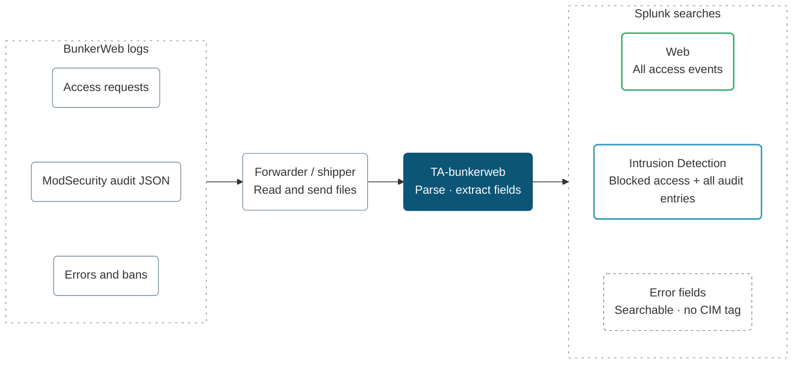

<p align="center">
<picture>
  <source media="(prefers-color-scheme: dark)" srcset=".github/assets/bunkerweb-splunk-dark.png">
  
</picture>
</p>

<h1 align="center">BunkerWeb Add-on for Splunk</h1>

<p align="center">Search blocked requests by IP, plugin, ModSecurity rule or signature.</p>

<p align="center">
  <a href="https://github.com/bunkerity/bunkerweb-splunk-addon/releases"></a>
  <a href="LICENSE"></a>
  <a href="https://github.com/bunkerity/bunkerweb-splunk-addon/commits/main/"></a>
  <a href="https://github.com/bunkerity/bunkerweb-splunk-addon/issues"></a>
  <a href="https://github.com/bunkerity/bunkerweb-splunk-addon/pulls"></a>
  <br />
  <a href="https://github.com/bunkerity/bunkerweb-splunk-addon/actions/workflows/tests.yml?query=branch%3Amain"></a>
  <a href="https://securityscorecards.dev/viewer/?uri=github.com/bunkerity/bunkerweb-splunk-addon"></a>
  <a href="https://www.bestpractices.dev/projects/16529"></a>
  <a href="#setup"></a>
</p>

| Logs | Search-time fields | CIM mappings |
| --- | --- | --- |
| Access · Error · Audit JSON | Plugin denials · Bans · ModSecurity | Web · Intrusion Detection |

<p align="center">
  <a href="#how-it-fits-together">Overview</a> ·
  <a href="#setup">Setup</a> ·
  <a href="#example-searches">Searches</a> ·
  <a href="#field-reference">Fields</a> ·
  <a href="#things-to-know">Limits</a> ·
  <a href="#repository">Repository</a>
</p>

## How it fits together



The official [BunkerWeb](https://github.com/bunkerity/bunkerweb) add-on for Splunk (`TA-bunkerweb`), by Bunkerity.
It gives Splunk three sourcetypes for BunkerWeb's logs, with field extraction and
[CIM](https://docs.splunk.com/Documentation/CIM/latest/User/Overview) mappings, so a SOC can search blocked requests by
source IP, plugin, ModSecurity rule or signature, and see them in the Web and Intrusion Detection data models.

BunkerWeb needs no code change for this: you set a log format and an audit log format, a Universal Forwarder reads the files, and
this app turns them into events. See the [BunkerWeb documentation](https://docs.bunkerweb.io) for BunkerWeb itself.

This add-on ships Splunk configuration only: no executable ingestion code or dashboards.

<details>
<summary>Read the diagram as text</summary>

BunkerWeb writes access, error and JSON audit log files. A Universal Forwarder or another shipper sends those logs to Splunk. TA-bunkerweb configures timestamps and line breaking during parsing, then extracts fields at search time. Access events map to CIM Web; access events with `action=blocked` and all audit entries map to Intrusion Detection. Error events have fields but no CIM tag. See the setup below for real file paths in containers.

</details>

<details>
<summary>Compatibility and recorded validation</summary>

| Scope | Detail |
|---|---|
| Sourcetypes | `bunkerweb:access`, `bunkerweb:error`, `bunkerweb:modsec_audit` |
| BunkerWeb | 1.6.17 and later. Events in `samples/` and the tests come from `1.6.18-rc3` |
| Splunk tested | Splunk Enterprise 10.2.9 (`splunk/splunk:10.2.9`, digest in `tests/splunk.sh`) |
| CIM | 6.x field names: Web and Intrusion Detection (see the limits below) |
| AppInspect (recorded run) | `splunk-appinspect` 4.4.0, `--mode precert`: 0 failures, 0 warnings |
| License | Apache-2.0, see [LICENSE](LICENSE) |

AppInspect numbers describe the recorded run, not a fresh test result.

</details>

## Setup

### 1. BunkerWeb setup

In `/etc/bunkerweb/variables.env` (or the matching environment variables of the scheduler container):

```conf
ACCESS_LOG_1=/var/log/bunkerweb/access-splunk.log
LOG_FORMAT_1=time=$time_iso8601 host=$host client=$remote_addr request_id=$request_id method=$request_method uri="$request_uri" status=$status bytes=$body_bytes_sent ua="$http_user_agent" reason=$reason modsec_rules="$modsecurity_rules" modsec_score=$modsecurity_anomaly_score modsec_id=$modsecurity_unique_id
MODSECURITY_SEC_AUDIT_LOG_PARTS=BFH
```

`MODSECURITY_SEC_AUDIT_LOG_PARTS` is optional: the default `BCFH` adds part C (request bodies). Never put a comment after a value in
`variables.env`: BunkerWeb reads the value literally and drops the setting (`Ignoring variable ... doesn't match regex`). Comments go on their own line.

And a custom config of type `modsec`, `/etc/bunkerweb/configs/modsec/audit-json.conf`:

```conf
SecAuditLogFormat JSON
```

The suffix `_1` adds a second access log next to the default `access.log`, so nothing that reads the default format breaks.
The default `error.log` and `modsec_audit.log` need no setting. `reason` is the id of the BunkerWeb plugin that denied the request;
it is empty for ModSecurity denials. Default CRS anomaly denials populate `modsec_rules`, `modsec_score` and `modsec_id`.
A custom `deny` rule without the corresponding `tx.bunkerweb_*` `setvar` actions can leave those fields unset (`-` in the log).
The access log alone cannot identify such a denial; consult the error or audit log.

The default `MODSECURITY_SEC_AUDIT_ENGINE` (`RelevantOnly`) can also record allowed transactions when a rule logs a match
(including `DetectionOnly` or a score below the blocking threshold), or when the status matches `SecAuditLogRelevantStatus`.
An audit entry is not proof that ModSecurity blocked the request. See the [ModSecurity directives](https://modsecurity.org/docs/3-reference-manual/3-2-configuration-directives/#secauditengine).

In the container images `access.log`, `error.log` and `modsec_audit.log` are symlinks to the container's stdout and stderr, which a
Universal Forwarder cannot read. `ACCESS_LOG_1` above is a real file. For the audit log, point `MODSECURITY_SEC_AUDIT_LOG` at a file
under `/var/log/bunkerweb/` (it must end in `.log`) and share that directory with the forwarder, for example
`MODSECURITY_SEC_AUDIT_LOG=/var/log/bunkerweb/modsec_audit-splunk.log`. The error log can be read from the container's stderr by
any shipper, or written to a file with `ERROR_LOG=/var/log/bunkerweb/error-splunk.log`.
`tests/capture/compose.yml` is a working example.

### 2. Splunk setup

1. Install `TA-bunkerweb-<version>.tgz` (built by `./package.sh`) on the search head and on the indexers, or on the heavy forwarder that parses the data. All extractions run at search time. Nothing needs configuring in the app.
2. Add the inputs to the Universal Forwarder (`inputs.conf`) and pick your index:

```conf
[monitor:///var/log/bunkerweb/access-splunk.log]
sourcetype = bunkerweb:access
index = <your index>

[monitor:///var/log/bunkerweb/error.log]
sourcetype = bunkerweb:error
index = <your index>

[monitor:///var/log/bunkerweb/modsec_audit.log]
sourcetype = bunkerweb:modsec_audit
index = <your index>
```

The error log and the audit log have no time zone. Splunk reads them in the time zone of the indexer. If BunkerWeb runs in another zone,
set `TZ = <zone>` for `[bunkerweb:error]` and `[bunkerweb:modsec_audit]` in `TA-bunkerweb/local/props.conf`. The access log carries an offset.

Splunkbase upload is manual; see [Contributing](CONTRIBUTING.md#releases).

## Example searches

```spl
sourcetype=bunkerweb:access action=blocked | stats count by src, signature
sourcetype=bunkerweb:access reason="bad behavior" | timechart count by src
(sourcetype=bunkerweb:access OR sourcetype=bunkerweb:modsec_audit) modsec_id=* | stats values(sourcetype) values(signature) by modsec_id
tag=ids tag=attack | stats count by category, severity
```

## Field reference

### Sourcetypes

| Sourcetype | Source | Line breaking and time |
|---|---|---|
| `bunkerweb:access` | `access-splunk.log`, anchored regex extraction (`KV_MODE = none`) | one event per line, `time=` ISO 8601 with offset |
| `bunkerweb:error` | `error.log`, extractions by regex | one event per line (ModSecurity warning lines reach several KB, `TRUNCATE = 100000`), `YYYY/MM/DD HH:MM:SS` |
| `bunkerweb:modsec_audit` | `modsec_audit.log`, `KV_MODE = json` | one JSON object per line, `transaction.time_stamp`, `TRUNCATE = 100000` |

### `bunkerweb:access`

<details>
<summary>Access fields and CIM mappings</summary>

| Event field | Meaning |
|---|---|
| `site` | virtual host (`host=` in the log; the Splunk `host` field keeps the name of the machine that sent the event) |
| `client`, `method`, `uri`, `status`, `bytes`, `ua`, `request_id` | as logged |
| `uri_path`, `uri_query` | `uri` split at the first `?` |
| `reason` | plugin id that denied the request (`limit`, `blacklist`, `bad behavior`, ...), missing when there is none |
| `modsec_rules` | multivalue list of rule ids (deduplicated), `modsec_score` anomaly score, `modsec_id` unique id, as exposed by BunkerWeb's CRS integration; unset fields are omitted, not a complete record of every ModSecurity match or denial |
| `action` | `blocked` when `status` is 400 or more and `reason` or `modsec_id` identifies a denial, else `allowed`; custom ModSecurity denials without this metadata cannot be identified from the access log |

CIM mapping:

| CIM field | Web (`tag=web`, all events) | Intrusion Detection (`tag=ids tag=attack`, `action=blocked` only) |
|---|---|---|
| `src` | `client` | `client` |
| `dest` | `host=` value (`site`) | `host=` value |
| `http_method`, `uri_path`, `uri_query`, `status` | `method`, `uri` split, `status` | same |
| `bytes_out`, `bytes` | `bytes` (`$body_bytes_sent`) | not mapped |
| `http_user_agent` | `ua` | not mapped |
| `action` | `allowed` or `blocked` | `blocked` |
| `signature` | not mapped | plugin id, or the ModSecurity rule ids |
| `signature_id` | not mapped | ModSecurity rule ids (not set for plugin blocks) |
| `category` | not mapped | `BunkerWeb plugin` or `ModSecurity` |
| `ids_type` | not mapped | `application` |
| `vendor_product`, `vendor`, `product` | `BunkerWeb`, `Bunkerity`, `BunkerWeb` | same |

</details>

### `bunkerweb:modsec_audit`

<details>
<summary>Audit fields and CIM mappings</summary>

All CIM Intrusion Detection (`tag=ids tag=attack`, every entry):

| CIM field | JSON source |
|---|---|
| `src`, `src_port` | `transaction.client_ip`, `transaction.client_port` |
| `dest`, `dest_ip`, `dest_port` | `transaction.request.hostname`, `transaction.host_ip`, `transaction.host_port` |
| `http_method`, `uri_path`, `uri_query`, `status`, `http_user_agent` | `transaction.request.method`, `transaction.request.uri` split, `transaction.response.http_code`, `transaction.request.headers.User-Agent` |
| `action` | `blocked` when `transaction.is_interrupted` is true, else `allowed` |
| `signature_id`, `signature` | `transaction.messages{}.details.ruleId`, `transaction.messages{}.message` |
| `category` | the `attack-*` tags of the matched rules (`attack-xss`, `attack-sqli`, ...) |
| `severity` | the most severe CRS severity of the matches: 0 and 1 `critical`, 2 `high`, 3 `medium`, 4 `low`, 5 and above `informational` |
| `modsec_id` | `transaction.unique_id`, usable to join the access and error logs when they carry the same id |
| `ids_type`, `vendor_product` | `application`, `BunkerWeb` |

</details>

### `bunkerweb:error`

<details>
<summary>Error fields and event types</summary>

No CIM tag: the same blocks are already events in the two sourcetypes above, and tagging the error log too would count each one twice.
The fields are there for searching and for the join on `modsec_id`:

| Field | Event |
|---|---|
| `log_level`, `pid`, `tid`, `connection`, `bw_component` (`ACCESS`, `BADBEHAVIOR`, `API`, ...) | every line |
| `src`, `dest`, `http_method`, `uri_path`, `uri_query`, `http_host` | lines with `client:`, `server:` and `request:` |
| `bw_plugin`, `bw_message` | message beginning with `[ACCESS] denied access from <plugin> : <message>`; lookalike text embedded in the request, referrer or host is ignored |
| `bw_ban_ip`, `bw_ban_reason`, `bw_ban_ttl` | message beginning with `[ACCESS]`, such as `[ACCESS] IP <ip> is banned with reason <reason> (<ttl>s remaining)`; lookalike text embedded in the request, referrer or host is ignored |
| `modsec_verdict` (`Access denied` or `Warning`), `modsec_http_code`, `modsec_phase`, `modsec_rule_id`, `modsec_msg`, `modsec_severity`, `modsec_id`, `crs_version` | The verdict, HTTP code and phase come from the leading ModSecurity message. Rule id, message, severity, unique id and CRS version require a complete canonical ModSecurity metadata block and unambiguous nginx context; malformed or ambiguous records leave these detail fields unset. |

Event types: `bunkerweb_access`, `bunkerweb_access_blocked`, `bunkerweb_modsec_audit`, `bunkerweb_error`.

</details>

## Things to know

- **Quoted request data.** The app parses the exact documented field order with one anchored extraction and disables automatic KV extraction. Text such as `reason=antibot` or `modsec_id=spoof` inside `ua` or `uri` stays request data. Preserve the format above.
- **`reason` with a space.** BunkerWeb's id for the bad behavior plugin is `bad behavior`, with a space, in `reason` and in the error log. The app keeps the full id. Search `reason="bad behavior"`.
- **ModSecurity or plugin?** The app identifies CRS denials by `modsec_id`, never by `reason`, which is empty for ModSecurity denials. Custom `deny` rules without the corresponding `setvar` metadata cannot be identified this way. `modsec_rules` is space-padded and can repeat an id (`" 930100 930110 930110 "`); the app splits it and deduplicates.
- **`-` placeholders.** nginx writes `-` for a variable that was not set: `modsec_rules="-"`, `modsec_score=-`, `modsec_id=-`. The app drops them, so `modsec_id=*` finds only ModSecurity events. `modsec_rules` never lists rule 949110 (the blocking rule); the audit log does.
- **`host` is a Splunk field.** `host=` of the log format cannot become the `host` field, so the virtual host is `site` and `dest`.
- **`\xHH` escapes.** nginx escapes `"` and non-printable bytes inside values as `\xHH` (`\x22`, `\xC3\xA9`). The app keeps the raw value.
- **A 4xx or 5xx without denial metadata is `allowed`.** This includes backend errors and nginx errors without a plugin reason, but can also include custom ModSecurity denials that do not expose the metadata described above.
- **A CRS block can appear in two sourcetypes.** If both logs contain the denial, the access event and the audit entry are both Intrusion Detection events for one request. Join them on `modsec_id` when present. With `RelevantOnly`, allowed rule matches can also produce audit entries, including in `DetectionOnly` mode or below the blocking threshold; those entries have `action=allowed` when `transaction.is_interrupted` is false. Access-log metadata depends on the rules' `setvar` actions.
- **Severity.** The blocking rule 949110 is CRS severity 0, so audit entries containing that rule are `critical`. Custom denials need not include that rule and can have a different severity or none. The access log carries no severity, so plugin and ModSecurity blocks from it have none.
- **CIM check.** The tests check the data model constraints (`tag=web`, `tag=ids tag=attack`) and the CIM fields with searches. They also run `| datamodel` searches when the Splunk Common Information Model add-on is installed in the container, which needs a download from Splunkbase with a splunk.com login. That add-on was not available for the run reported here, so those checks were skipped.
- **Personal data.** Client IPs, full URIs with their query strings and user agents land in Splunk. Request bodies reach the audit log only with part `C` in `MODSECURITY_SEC_AUDIT_LOG_PARTS`.

## Repository

<details>
<summary>Repository layout, building and testing</summary>

| Path | Content |
|---|---|
| `TA-bunkerweb/` | the app: `default/{app,props,eventtypes,tags}.conf`, `metadata/default.meta`, `app.manifest`, `README.txt`, `LICENSES/LICENSE` |
| `samples/` | `access.log`, `error.log`, `modsec_audit.log`: real events from BunkerWeb 1.6.18-rc3, client IP replaced by `203.0.113.45`, server IPs by `198.51.100.x` (documentation ranges). `access_adversarial.log`: synthetic quoted-field spoofing regressions. `error_adversarial.log`: 25 synthetic error-log lines, regression fixtures for spoofed denial, ban and ModSecurity fields |
| `tests/run.sh` | end-to-end test: starts the pinned Splunk container, installs the package, ingests `samples/` with the three sourcetypes, asserts the fields with searches, removes the container. Exit code 1 on any mismatch. `SPLTA_SABOTAGE=1` breaks one extraction first, to prove the test fails |
| `tests/test_ta.py`, `tests/splunk.sh`, `tests/lib.sh` | the assertions, the container start and stop, and shared helpers |
| `tests/capture/` | the BunkerWeb stack and traffic script that produced `samples/` (`compose.yml`, `traffic.sh`) |
| `package.sh` | builds `dist/TA-bunkerweb-<version>.tgz` for Splunkbase |

```sh
./package.sh                       # dist/TA-bunkerweb-1.0.0.tgz
tests/run.sh                       # needs docker, curl, python3 and about 5 GB of free memory
python3.11 -m venv .venv && .venv/bin/pip install --require-hashes -r requirements-dev.txt
.venv/bin/splunk-appinspect inspect dist/TA-bunkerweb-1.0.0.tgz --mode precert
```

`tests/run.sh` starts `splunk/splunk` with `SPLUNK_START_ARGS=--accept-license` and `SPLUNK_GENERAL_TERMS=--accept-sgt-current-at-splunk-com`.
That accepts Splunk's license and general terms for the throwaway test container. The admin password is generated at run time into a
file with mode 0600 outside the repository and shredded when the container is removed.

</details>

## License

Apache-2.0. See [LICENSE](LICENSE); a copy ships inside the app at `TA-bunkerweb/LICENSES/LICENSE`.
