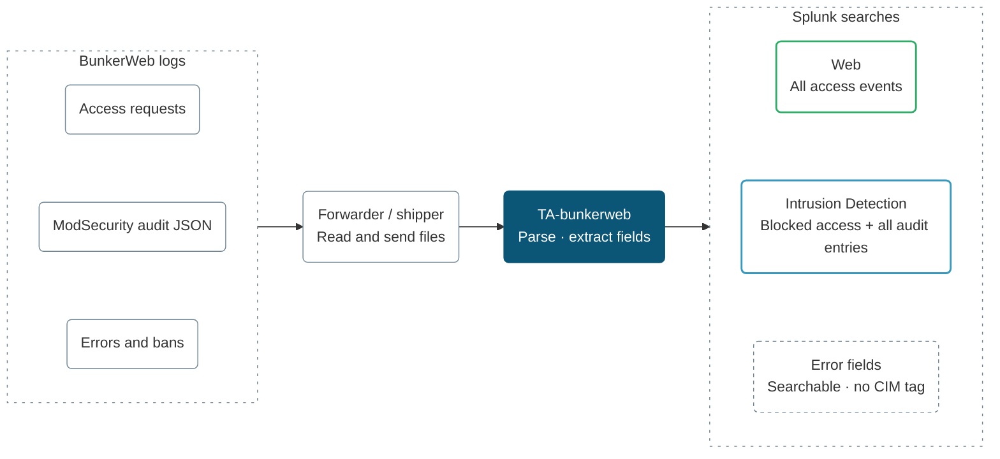

<p align="center">
<picture>
  <source media="(prefers-color-scheme: dark)" srcset=".github/assets/bunkerweb-splunk-dark.png">
  
</picture>
</p>

<h1 align="center">BunkerWeb Add-on for Splunk</h1>

<p align="center">Search blocked requests by IP, plugin, ModSecurity rule or signature.</p>

<p align="center">
  <a href="https://github.com/bunkerity/bunkerweb-splunk-addon/releases"></a>
  <a href="LICENSE"></a>
  <a href="https://github.com/bunkerity/bunkerweb-splunk-addon/commits/main/"></a>
  <a href="https://github.com/bunkerity/bunkerweb-splunk-addon/issues"></a>
  <a href="https://github.com/bunkerity/bunkerweb-splunk-addon/pulls"></a>
  <br />
  <a href="https://github.com/bunkerity/bunkerweb-splunk-addon/actions/workflows/tests.yml?query=branch%3Amain"></a>
  <a href="https://securityscorecards.dev/viewer/?uri=github.com/bunkerity/bunkerweb-splunk-addon"></a>
  <a href="https://www.bestpractices.dev/projects/16529"></a>
  <a href="#setup"></a>
  <a href="https://splunkbase.splunk.com/app/10342"></a>
</p>

| Logs | Search-time fields | CIM mappings |
| --- | --- | --- |
| Access · Error · Audit JSON | Plugin denials · Bans · ModSecurity | Web · Intrusion Detection |

<p align="center">
  <a href="#how-it-fits-together">Overview</a> ·
  <a href="#setup">Setup</a> ·
  <a href="#example-searches">Searches</a> ·
  <a href="#field-reference">Fields</a> ·
  <a href="#things-to-know">Limits</a> ·
  <a href="#repository">Repository</a>
</p>

## How it fits together



The official [BunkerWeb](https://github.com/bunkerity/bunkerweb) add-on for Splunk (`TA-bunkerweb`), by Bunkerity.
It gives Splunk three sourcetypes for BunkerWeb's logs, with field extraction and
[CIM](https://docs.splunk.com/Documentation/CIM/latest/User/Overview) mappings, so a SOC can search blocked requests by
source IP, plugin, ModSecurity rule or signature, and see them in the Web and Intrusion Detection data models.

BunkerWeb needs no code change for this: you set a log format and an audit log format, a Universal Forwarder reads the files, and
this app turns them into events. See the [BunkerWeb documentation](https://docs.bunkerweb.io/1.6/) for BunkerWeb itself.

This add-on ships Splunk configuration only: no executable ingestion code or dashboards.

<details>
<summary>Read the diagram as text</summary>

BunkerWeb writes access, error and JSON audit log files. A Universal Forwarder or another shipper sends those logs to Splunk. TA-bunkerweb configures timestamps and line breaking during parsing, then extracts fields at search time. Access events map to CIM Web; access events with `action=blocked` and all audit entries map to Intrusion Detection. Error events have fields but no CIM tag. See the setup below for real file paths in containers.

</details>

<details>
<summary>Compatibility and recorded validation</summary>

| Scope | Detail |
|---|---|
| Sourcetypes | `bunkerweb:access`, `bunkerweb:error`, `bunkerweb:modsec_audit` |
| BunkerWeb | 1.6.17 and later. Events in `samples/` and the tests come from `1.6.18-rc3` |
| Splunk tested | Splunk Enterprise 10.2.9 (`splunk/splunk:10.2.9`, digest in `tests/splunk.sh`) |
| CIM | 6.x field names: Web and Intrusion Detection (see the limits below) |
| AppInspect (recorded run) | `splunk-appinspect` 4.4.0, `--mode precert`: 0 failures, 1 private-app warning |
| Setup examples run live | 2026-11-17, BunkerWeb 1.6.17 images, Docker 29, Compose 5.7.1: the Docker example with the `splunk/universalforwarder:10.2.9` container (one allowed and one XSS request; `splunkd` ran as root and read the three files to the end, with no `Permission denied`; with `group_add: ["101"]` instead it could not read them), its `logrotate` service, the Kubernetes init container and mount as a bind-mount variant, and the all-in-one example (read by a plain container, not by a forwarder). Run on `helm template` only: the Kubernetes values. Not run: Linux packages, Docker autoconf, Swarm, a cluster, delivery to an indexer |
| License | Apache-2.0, see [LICENSE](LICENSE) |

AppInspect numbers describe the recorded run, not a fresh test result.
The `check_for_updates_disabled` warning targets private apps. This public Splunkbase-hosted add-on must keep update checks enabled.

</details>

## Setup

### 1. BunkerWeb setup

Every integration needs the same settings. Only where you put them changes.

| What | Setting |
|---|---|
| A second access log in `key=value` format | `ACCESS_LOG_1` and `LOG_FORMAT_1` |
| The ModSecurity audit log as JSON | a custom configuration of type `modsec` containing `SecAuditLogFormat JSON` |
| Optional: no request bodies in the audit log | `MODSECURITY_SEC_AUDIT_LOG_PARTS=BFH` |
| Containers only: real files for the error log and the audit log | `ERROR_LOG_1` and `MODSECURITY_SEC_AUDIT_LOG` |

The access log format, written once. Each example below spells it with its own escaping and nothing else changed:

```conf
time=$time_iso8601 host=$host client=$remote_addr request_id=$request_id method=$request_method uri="$request_uri" status=$status bytes=$body_bytes_sent ua="$http_user_agent" reason=$reason modsec_rules="$modsecurity_rules" modsec_score=$modsecurity_anomaly_score modsec_id=$modsecurity_unique_id
```

- **JSON audit log and BunkerWeb versions.** On 1.6.17 the `modsec` custom configuration is the only way, so every example uses it. BunkerWeb 1.6.18 adds the setting `MODSECURITY_SEC_AUDIT_LOG_FORMAT=JSON`, which replaces the custom configuration there. The default value (`Native`) writes no directive, so a custom configuration that sets `SecAuditLogFormat JSON` keeps working on 1.6.18 too.
- **`variables.env` is read literally.** Never put a comment after a value (`Ignoring variable ... doesn't match regex`): BunkerWeb takes it as part of the value and drops the setting. Comments go on their own line. No quotes around values either.
- **`MODSECURITY_SEC_AUDIT_LOG_PARTS` is optional.** The default `BCFH` adds part C, the request bodies (see Personal data below). `BFH` leaves them out.
- **What the settings do.** The suffix `_1` adds a second access log next to the default `access.log`, so nothing that reads the default format breaks. `reason` is the id of the BunkerWeb plugin that denied the request. It is empty for ModSecurity denials. Default CRS anomaly denials populate `modsec_rules`, `modsec_score` and `modsec_id`. A custom `deny` rule without the corresponding `tx.bunkerweb_*` `setvar` actions can leave those fields unset (`-` in the log). The access log alone cannot identify such a denial; consult the error or audit log.
- **The audit log is not proof of blocking.** The default `MODSECURITY_SEC_AUDIT_ENGINE` (`RelevantOnly`) can also record allowed transactions when a rule logs a match (including `DetectionOnly` or a score below the blocking threshold), or when the status matches `SecAuditLogRelevantStatus`. See the [ModSecurity directives](https://modsecurity.org/docs/3-reference-manual/3-2-configuration-directives/#secauditengine).
- **Containers: why files, and who rotates them.** In the container images `access.log`, `error.log` and `modsec_audit.log` are symlinks to the container's stdout and stderr, which a Universal Forwarder cannot read. `ACCESS_LOG_1` is a real file. `ERROR_LOG_1` adds a real error log and the error log still goes to stderr. `MODSECURITY_SEC_AUDIT_LOG` replaces the audit log: it must be a `.log` file directly under `/var/log/bunkerweb/`, so the audit entries no longer reach `docker logs`. Share that directory with the forwarder through a volume. A named volume copies the image's `/var/log/bunkerweb` the first time it is used, with its links and its permissions (owner `root`, group `101`, mode `770`). A bind mount of an empty host directory hides the links, so use a named volume, or recreate the links as the Kubernetes example does. A forwarder must be root or in group `101` to enter the directory. The files themselves are readable by everyone. The stock Universal Forwarder image starts `splunkd` through `sudo`, which drops the supplementary groups of the container, so `group_add: ["101"]` never reaches `splunkd` (it logs `Permission denied` on all three files). The examples below set the image's own `SPLUNK_USER` and `SPLUNK_GROUP` to `root` instead.
- **Containers: nothing rotates the files.** The `bunkerweb` and scheduler images have no `logrotate` and no job that deletes logs, and BunkerWeb's own documentation says the same. The files grow until the volume is full. The Docker example below has one way to bound them. The all-in-one image is the exception: it runs `logrotate` itself.

Pick your integration. Each example is the change for that integration; the compatibility table above says which ones were run.

<details>
<summary><b>Linux</b> (packages, systemd)</summary>

In `/etc/bunkerweb/variables.env`:

```conf
ACCESS_LOG_1=/var/log/bunkerweb/access-splunk.log
LOG_FORMAT_1=time=$time_iso8601 host=$host client=$remote_addr request_id=$request_id method=$request_method uri="$request_uri" status=$status bytes=$body_bytes_sent ua="$http_user_agent" reason=$reason modsec_rules="$modsecurity_rules" modsec_score=$modsecurity_anomaly_score modsec_id=$modsecurity_unique_id
MODSECURITY_SEC_AUDIT_LOG_PARTS=BFH
```

And a custom configuration of type `modsec`, `/etc/bunkerweb/configs/modsec/audit-json.conf`:

```conf
SecAuditLogFormat JSON
```

Restart both services: `sudo systemctl restart bunkerweb bunkerweb-scheduler`.

The default `error.log` and `modsec_audit.log` need no setting. The files belong to `nginx:nginx` and the packages restrict access to that user and group. Add the user that runs the forwarder to the `nginx` group, then monitor the three files listed in step 2 for Linux. The packages install `/etc/logrotate.d/bunkerweb`, which rotates every `/var/log/bunkerweb/*.log` daily or at 100 MB, so `access-splunk.log` is covered with the other files.

The Microsoft Azure integration (Marketplace image, ARM template, Cloud Shell) is this same Linux setup on a virtual machine.

</details>

<details>
<summary><b>Docker</b></summary>

Settings go on the scheduler, the log directory is a named volume, and a second container reads it. Add this to your stack. The image tags pin the current stable BunkerWeb release (1.6.17); keep every BunkerWeb image on the same tag. In Compose, a literal `$` is written `$$`.

```yaml
services:
  bunkerweb:
    image: bunkerity/bunkerweb:1.6.17
    volumes:
      - bw-logs:/var/log/bunkerweb

  bw-scheduler:
    image: bunkerity/bunkerweb-scheduler:1.6.17
    environment:
      ACCESS_LOG_1: "/var/log/bunkerweb/access-splunk.log"
      LOG_FORMAT_1: 'time=$$time_iso8601 host=$$host client=$$remote_addr request_id=$$request_id method=$$request_method uri="$$request_uri" status=$$status bytes=$$body_bytes_sent ua="$$http_user_agent" reason=$$reason modsec_rules="$$modsecurity_rules" modsec_score=$$modsecurity_anomaly_score modsec_id=$$modsecurity_unique_id'
      ERROR_LOG_1: "/var/log/bunkerweb/error-splunk.log"
      MODSECURITY_SEC_AUDIT_LOG: "/var/log/bunkerweb/modsec_audit-splunk.log"
      MODSECURITY_SEC_AUDIT_LOG_PARTS: "BFH"
      CUSTOM_CONF_MODSEC_audit-json: "SecAuditLogFormat JSON"

  splunk-forwarder:
    image: splunk/universalforwarder:10.2.9
    environment:
      # Setting these two accepts Splunk's licence terms
      SPLUNK_START_ARGS: "--accept-license"
      SPLUNK_GENERAL_TERMS: "--accept-sgt-current-at-splunk-com"
      SPLUNK_PASSWORD: "<a password for the forwarder>"
      # splunkd as root, because the image drops group 101 (see above)
      SPLUNK_USER: "root"
      SPLUNK_GROUP: "root"
      # The three monitors of step 2 for containers; replace <index>.
      # Add "forward-server <indexer>:9997" to send the events to your indexer
      SPLUNK_ADD: "monitor /var/log/bunkerweb/access-splunk.log -sourcetype bunkerweb:access -index <index>,monitor /var/log/bunkerweb/error-splunk.log -sourcetype bunkerweb:error -index <index>,monitor /var/log/bunkerweb/modsec_audit-splunk.log -sourcetype bunkerweb:modsec_audit -index <index>"
    volumes:
      - bw-logs:/var/log/bunkerweb:ro

volumes:
  bw-logs:
```

Keep the rest of your stack as it is. The scheduler variables are the only BunkerWeb settings. Recreate the containers. `SPLUNK_ADD` is the image's way to add inputs; a read-only bind mount of your own `inputs.conf` stops the image's start-up. To read the volume from a forwarder installed on the Docker host instead, find the directory with `docker volume inspect bw-logs`, add the forwarder's user to the group with id `101` (or run it as root) and use the `inputs.conf` block of step 2 for containers.

Rotation is optional, and this is one way to do it. A small extra service runs `logrotate` hourly on the same volume. It rotates with `copytruncate`, which BunkerWeb needs because ModSecurity never reopens its audit file. It needs internet access once, to install `logrotate`. `su root nginx` is needed because the directory is writable by group `101`, and `logrotate` takes names, not ids.

```yaml
services:
  bw-logrotate:
    image: alpine:3.24
    command:
      - sh
      - -c
      - addgroup -g 101 nginx && apk add --no-cache logrotate && while :; do logrotate -s /tmp/logrotate.status /etc/logrotate.conf; sleep 3600; done
    configs:
      - source: splunk-logrotate
        target: /etc/logrotate.conf
    volumes:
      - bw-logs:/var/log/bunkerweb

configs:
  splunk-logrotate:
    content: |
      /var/log/bunkerweb/*-splunk.log {
          su root nginx
          daily
          maxsize 100M
          rotate 14
          compress
          missingok
          notifempty
          copytruncate
      }

volumes:
  bw-logs:
```

Merge it into the same file. The `configs` `content:` key needs Docker Compose 2.23 or later. Rotated copies are named `access-splunk.log.1.gz` and so on, which the monitor stanzas in step 2 do not match.

</details>

<details>
<summary><b>Docker autoconf</b></summary>

The Docker example applies as it is: the same scheduler variables (including `CUSTOM_CONF_MODSEC_audit-json`), the same `bw-logs` volume on the `bunkerweb` container, the same forwarder and rotation services. Use the tag `1.6.17` for `bunkerity/bunkerweb-autoconf` too. The scheduler reads `CUSTOM_CONF_*` variables in autoconf mode as well, and without a service name the configuration applies to every service, so one variable covers them all. This example is not run live.

</details>

<details>
<summary><b>Swarm</b> (deprecated in BunkerWeb)</summary>

BunkerWeb marks the Swarm integration as deprecated and plans to remove it. This example is not run live. It is the Docker autoconf setup with services instead of containers. A Swarm volume with the default driver lives on one node, so run `bunkerweb` and the forwarder as global services: every node gets its own copy of the volume and a forwarder next to it. In a stack file `$` is written `$$`, as in Compose.

```yaml
services:
  bunkerweb:
    image: bunkerity/bunkerweb:1.6.17
    volumes:
      - bw-logs:/var/log/bunkerweb
    deploy:
      mode: global

  bw-scheduler:
    image: bunkerity/bunkerweb-scheduler:1.6.17
    environment:
      ACCESS_LOG_1: "/var/log/bunkerweb/access-splunk.log"
      LOG_FORMAT_1: 'time=$$time_iso8601 host=$$host client=$$remote_addr request_id=$$request_id method=$$request_method uri="$$request_uri" status=$$status bytes=$$body_bytes_sent ua="$$http_user_agent" reason=$$reason modsec_rules="$$modsecurity_rules" modsec_score=$$modsecurity_anomaly_score modsec_id=$$modsecurity_unique_id'
      ERROR_LOG_1: "/var/log/bunkerweb/error-splunk.log"
      MODSECURITY_SEC_AUDIT_LOG: "/var/log/bunkerweb/modsec_audit-splunk.log"
      MODSECURITY_SEC_AUDIT_LOG_PARTS: "BFH"
      CUSTOM_CONF_MODSEC_audit-json: "SecAuditLogFormat JSON"

  splunk-forwarder:
    image: splunk/universalforwarder:10.2.9
    environment:
      SPLUNK_START_ARGS: "--accept-license"
      SPLUNK_GENERAL_TERMS: "--accept-sgt-current-at-splunk-com"
      SPLUNK_PASSWORD: "<a password for the forwarder>"
      SPLUNK_USER: "root"
      SPLUNK_GROUP: "root"
      SPLUNK_ADD: "monitor /var/log/bunkerweb/access-splunk.log -sourcetype bunkerweb:access -index <index>,monitor /var/log/bunkerweb/error-splunk.log -sourcetype bunkerweb:error -index <index>,monitor /var/log/bunkerweb/modsec_audit-splunk.log -sourcetype bunkerweb:modsec_audit -index <index>"
    volumes:
      - bw-logs:/var/log/bunkerweb:ro
    deploy:
      mode: global

volumes:
  bw-logs:
```

The scheduler reads `CUSTOM_CONF_*` variables in Swarm mode as well. The forwarder settings are explained in the Docker example. For rotation, merge this global service into the same stack file. Swarm needs a file-backed config instead of Compose's `content:`:

```yaml
services:
  bw-logrotate:
    image: alpine:3.24
    command:
      - sh
      - -c
      - addgroup -g 101 nginx && apk add --no-cache logrotate && while :; do logrotate -s /tmp/logrotate.status /etc/logrotate.conf; sleep 3600; done
    configs:
      - source: splunk-logrotate
        target: /etc/logrotate.conf
    volumes:
      - bw-logs:/var/log/bunkerweb
    deploy:
      mode: global

configs:
  splunk-logrotate:
    file: ./splunk-logrotate.conf
```

Save the same rotation policy as `splunk-logrotate.conf` next to the stack file:

```conf
/var/log/bunkerweb/*-splunk.log {
    su root nginx
    daily
    maxsize 100M
    rotate 14
    compress
    missingok
    notifempty
    copytruncate
}
```

</details>

<details>
<summary><b>Kubernetes</b></summary>

This example is rendered with `helm template` but not run on a cluster. The chart has volume, volume mount and init container values for the BunkerWeb pod, but none for an extra container, so the simplest forwarder is one installed on each node, reading a `hostPath` directory. A `DaemonSet` puts one BunkerWeb pod on each node. Chart 1.3.0 ships BunkerWeb 1.6.17. Your namespace must allow a `hostPath` volume and one init container that runs as root.

Chart values, `values-splunk.yaml`. The init container gives uid 101 (the BunkerWeb user) the directory and recreates the stdout and stderr links the image has in `/var/log/bunkerweb`, which the mount hides. Without them nginx would create `access.log` and `error.log` there as plain files that nothing rotates.

```yaml
bunkerweb:
  kind: DaemonSet
  initContainers:
    - name: splunk-logs-init
      image: alpine:3.24
      securityContext:
        runAsUser: 0
      command:
        - sh
        - -c
        - >-
          chown 101:101 /logs && chmod 770 /logs &&
          ln -sf /proc/1/fd/1 /logs/access.log &&
          ln -sf /proc/1/fd/2 /logs/error.log &&
          ln -sf /proc/1/fd/2 /logs/modsec_audit.log
      volumeMounts:
        - name: splunk-logs
          mountPath: /logs
  volumes:
    - name: splunk-logs
      hostPath:
        path: /var/log/bunkerweb
        type: DirectoryOrCreate
  volumeMounts:
    - name: splunk-logs
      mountPath: /var/log/bunkerweb
```

The settings and the audit format are two ConfigMaps that the BunkerWeb controller watches. The annotation `bunkerweb.io/CONFIG_TYPE: settings` makes it read each key as a global setting. `LOG_FORMAT_1` is literal here: Kubernetes does not expand `$`.

```yaml
apiVersion: v1
kind: ConfigMap
metadata:
  name: cfg-bunkerweb-splunk-settings
  annotations:
    bunkerweb.io/CONFIG_TYPE: "settings"
data:
  ACCESS_LOG_1: "/var/log/bunkerweb/access-splunk.log"
  LOG_FORMAT_1: 'time=$time_iso8601 host=$host client=$remote_addr request_id=$request_id method=$request_method uri="$request_uri" status=$status bytes=$body_bytes_sent ua="$http_user_agent" reason=$reason modsec_rules="$modsecurity_rules" modsec_score=$modsecurity_anomaly_score modsec_id=$modsecurity_unique_id'
  ERROR_LOG_1: "/var/log/bunkerweb/error-splunk.log"
  MODSECURITY_SEC_AUDIT_LOG: "/var/log/bunkerweb/modsec_audit-splunk.log"
  MODSECURITY_SEC_AUDIT_LOG_PARTS: "BFH"
---
apiVersion: v1
kind: ConfigMap
metadata:
  name: cfg-bunkerweb-splunk-audit-json
  annotations:
    bunkerweb.io/CONFIG_TYPE: "modsec"
data:
  audit-json: |
    SecAuditLogFormat JSON
```

```sh
helm upgrade --install mybunkerweb bunkerweb/bunkerweb -n bunkerweb -f values-splunk.yaml
kubectl apply -n bunkerweb -f bunkerweb-splunk.yaml
```

Install the Universal Forwarder on each node and monitor the three files in step 2 for containers. The forwarder's user must be root or in the group with id `101`. Nothing rotates the files on the node. Use the node's own `logrotate` with the policy from the Docker example, with `su` naming the user and group that own uid and gid `101` on that node.

</details>

<details>
<summary><b>All-in-one</b></summary>

The all-in-one image is the exception to the symlinks: it keeps `access.log`, `error.log` and `modsec_audit.log` as real files in `/var/log/bunkerweb/`, and it runs `logrotate` hourly with the policy the Linux packages install. That policy rotates every `/var/log/bunkerweb/*.log` file daily or at 100 MB, so `access-splunk.log` is covered too, and nothing else is needed. You only share the directory with the forwarder. The error log and the audit log need no setting.

```sh
docker run -d \
  --name bunkerweb-aio \
  -v bw-storage:/data \
  -v bw-logs:/var/log/bunkerweb \
  -e SERVER_NAME=www.example.com \
  -e ACCESS_LOG_1=/var/log/bunkerweb/access-splunk.log \
  -e 'LOG_FORMAT_1=time=$time_iso8601 host=$host client=$remote_addr request_id=$request_id method=$request_method uri="$request_uri" status=$status bytes=$body_bytes_sent ua="$http_user_agent" reason=$reason modsec_rules="$modsecurity_rules" modsec_score=$modsecurity_anomaly_score modsec_id=$modsecurity_unique_id' \
  -e MODSECURITY_SEC_AUDIT_LOG_PARTS=BFH \
  -e 'CUSTOM_CONF_MODSEC_audit-json=SecAuditLogFormat JSON' \
  -p 80:8080/tcp \
  -p 443:8443/tcp \
  -p 443:8443/udp \
  bunkerity/bunkerweb-all-in-one:1.6.17
```

The single quotes keep the shell from expanding `$`. Run the forwarder as in the Docker example (the volume read-only, `SPLUNK_USER` and `SPLUNK_GROUP` set to `root`), but give `SPLUNK_ADD` the three files of step 2 for Linux and all-in-one: `access-splunk.log`, `error.log` and `modsec_audit.log`.

</details>

<details>
<summary><b>BunkerWeb Cloud and Terraform</b></summary>

BunkerWeb Cloud is a managed service run by Bunkerity: there is no host of yours to put a forwarder on, so none of the examples above applies. Ask Bunkerity about log export. The Terraform provider manages the settings and custom configurations of a BunkerWeb instance that you run yourself (`bunkerweb_global_config_setting` for the settings, `bunkerweb_config` for the `modsec` custom configuration). Apply the example for how that instance runs: Linux, Docker or Kubernetes.

</details>

### 2. Splunk setup

1. Install the add-on from [Splunkbase](https://splunkbase.splunk.com/app/10342): in Splunk Web, go to Apps > Find More Apps and search for BunkerWeb, or download the package from the listing. Alternatively, download `TA-bunkerweb-<version>.tgz` from a [GitHub release](https://github.com/bunkerity/bunkerweb-splunk-addon/releases) and verify it against the release's `SHA256SUMS`. You can also build the package with `./package.sh`. Install it on the search head and on the indexers, or on the heavy forwarder that parses the data. All extractions run at search time. Nothing needs configuring in the app.
2. Add the inputs to the Universal Forwarder (`inputs.conf`) and pick your index. The sourcetype names never change; only the file names depend on the integration.

   Linux and all-in-one (the default `error.log` and `modsec_audit.log`):

```conf
[monitor:///var/log/bunkerweb/access-splunk.log]
sourcetype = bunkerweb:access
index = <your index>

[monitor:///var/log/bunkerweb/error.log]
sourcetype = bunkerweb:error
index = <your index>

[monitor:///var/log/bunkerweb/modsec_audit.log]
sourcetype = bunkerweb:modsec_audit
index = <your index>
```

   Docker, Docker autoconf, Swarm and Kubernetes (the files from `ERROR_LOG_1` and `MODSECURITY_SEC_AUDIT_LOG`):

```conf
[monitor:///var/log/bunkerweb/access-splunk.log]
sourcetype = bunkerweb:access
index = <your index>

[monitor:///var/log/bunkerweb/error-splunk.log]
sourcetype = bunkerweb:error
index = <your index>

[monitor:///var/log/bunkerweb/modsec_audit-splunk.log]
sourcetype = bunkerweb:modsec_audit
index = <your index>
```

The error log and the audit log have no time zone. Splunk reads them in the time zone of the indexer. If BunkerWeb runs in another zone,
set `TZ = <zone>` for `[bunkerweb:error]` and `[bunkerweb:modsec_audit]` in `TA-bunkerweb/local/props.conf`. The access log carries an offset.

Splunkbase upload is manual; see [Contributing](CONTRIBUTING.md#releases).

## Example searches

```spl
sourcetype=bunkerweb:access action=blocked | stats count by src, signature
sourcetype=bunkerweb:access reason="bad behavior" | timechart count by src
(sourcetype=bunkerweb:access OR sourcetype=bunkerweb:modsec_audit) modsec_id=* | stats values(sourcetype) values(signature) by modsec_id
tag=ids tag=attack | stats count by category, severity
```

## Field reference

### Sourcetypes

| Sourcetype | Source | Line breaking and time |
|---|---|---|
| `bunkerweb:access` | `access-splunk.log`, anchored regex extraction (`KV_MODE = none`) | one event per line, `time=` ISO 8601 with offset |
| `bunkerweb:error` | `error.log`, extractions by regex | one event per line (ModSecurity warning lines reach several KB, `TRUNCATE = 100000`), `YYYY/MM/DD HH:MM:SS` |
| `bunkerweb:modsec_audit` | `modsec_audit.log`, `KV_MODE = json` | one JSON object per line, `transaction.time_stamp`, `TRUNCATE = 100000` |

### `bunkerweb:access`

<details>
<summary>Access fields and CIM mappings</summary>

| Event field | Meaning |
|---|---|
| `site` | virtual host (`host=` in the log; the Splunk `host` field keeps the name of the machine that sent the event) |
| `client`, `method`, `uri`, `status`, `bytes`, `ua`, `request_id` | as logged |
| `uri_path`, `uri_query` | `uri` split at the first `?` |
| `reason` | plugin id that denied the request (`limit`, `blacklist`, `bad behavior`, ...), missing when there is none |
| `modsec_rules` | multivalue list of rule ids (deduplicated), `modsec_score` anomaly score, `modsec_id` unique id, as exposed by BunkerWeb's CRS integration; unset fields are omitted, not a complete record of every ModSecurity match or denial |
| `action` | `blocked` when `status` is 400 or more and `reason` or `modsec_id` identifies a denial, else `allowed`; custom ModSecurity denials without this metadata cannot be identified from the access log |

CIM mapping:

| CIM field | Web (`tag=web`, all events) | Intrusion Detection (`tag=ids tag=attack`, `action=blocked` only) |
|---|---|---|
| `src` | `client` | `client` |
| `dest` | `host=` value (`site`) | `host=` value |
| `http_method`, `uri_path`, `uri_query`, `status` | `method`, `uri` split, `status` | same |
| `bytes_out`, `bytes` | `bytes` (`$body_bytes_sent`) | not mapped |
| `http_user_agent` | `ua` | not mapped |
| `action` | `allowed` or `blocked` | `blocked` |
| `signature` | not mapped | plugin id, or the ModSecurity rule ids |
| `signature_id` | not mapped | ModSecurity rule ids (not set for plugin blocks) |
| `category` | not mapped | `BunkerWeb plugin` or `ModSecurity` |
| `ids_type` | not mapped | `application` |
| `vendor_product`, `vendor`, `product` | `BunkerWeb`, `Bunkerity`, `BunkerWeb` | same |

</details>

### `bunkerweb:modsec_audit`

<details>
<summary>Audit fields and CIM mappings</summary>

All CIM Intrusion Detection (`tag=ids tag=attack`, every entry):

| CIM field | JSON source |
|---|---|
| `src`, `src_port` | `transaction.client_ip`, `transaction.client_port` |
| `dest`, `dest_ip`, `dest_port` | `transaction.request.hostname`, `transaction.host_ip`, `transaction.host_port` |
| `http_method`, `uri_path`, `uri_query`, `status`, `http_user_agent` | `transaction.request.method`, `transaction.request.uri` split, `transaction.response.http_code`, `transaction.request.headers.User-Agent` |
| `action` | `blocked` when `transaction.is_interrupted` is true, else `allowed` |
| `signature_id`, `signature` | `transaction.messages{}.details.ruleId`, `transaction.messages{}.message` |
| `category` | the `attack-*` tags of the matched rules (`attack-xss`, `attack-sqli`, ...) |
| `severity` | the most severe CRS severity of the matches: 0 and 1 `critical`, 2 `high`, 3 `medium`, 4 `low`, 5 and above `informational` |
| `modsec_id` | `transaction.unique_id`, usable to join the access and error logs when they carry the same id |
| `ids_type`, `vendor_product` | `application`, `BunkerWeb` |

</details>

### `bunkerweb:error`

<details>
<summary>Error fields and event types</summary>

No CIM tag: the same blocks are already events in the two sourcetypes above, and tagging the error log too would count each one twice.
The fields are there for searching and for the join on `modsec_id`:

| Field | Event |
|---|---|
| `log_level`, `pid`, `tid`, `connection`, `bw_component` (`ACCESS`, `BADBEHAVIOR`, `API`, ...) | every line |
| `src`, `dest`, `http_method`, `uri_path`, `uri_query`, `http_host` | lines with `client:`, `server:` and `request:` |
| `bw_plugin`, `bw_message` | message beginning with `[ACCESS] denied access from <plugin> : <message>`; lookalike text embedded in the request, referrer or host is ignored |
| `bw_ban_ip`, `bw_ban_reason`, `bw_ban_ttl` | message beginning with `[ACCESS]`, such as `[ACCESS] IP <ip> is banned with reason <reason> (<ttl>s remaining)`; lookalike text embedded in the request, referrer or host is ignored |
| `modsec_verdict` (`Access denied` or `Warning`), `modsec_http_code`, `modsec_phase`, `modsec_rule_id`, `modsec_msg`, `modsec_severity`, `modsec_id`, `crs_version` | The verdict, HTTP code and phase come from the leading ModSecurity message. Rule id, message, severity, unique id and CRS version require a complete canonical ModSecurity metadata block and unambiguous nginx context; malformed or ambiguous records leave these detail fields unset. |

Event types: `bunkerweb_access`, `bunkerweb_access_blocked`, `bunkerweb_modsec_audit`, `bunkerweb_error`.

</details>

## Things to know

- **Release notifications.** Splunkbase update checks are enabled so Splunk can notify administrators when a new add-on version is available.
- **Quoted request data.** The app parses the exact documented field order with one anchored extraction and disables automatic KV extraction. Text such as `reason=antibot` or `modsec_id=spoof` inside `ua` or `uri` stays request data. Preserve the format above.
- **`reason` with a space.** BunkerWeb's id for the bad behavior plugin is `bad behavior`, with a space, in `reason` and in the error log. The app keeps the full id. Search `reason="bad behavior"`.
- **ModSecurity or plugin?** The app identifies CRS denials by `modsec_id`, never by `reason`, which is empty for ModSecurity denials. Custom `deny` rules without the corresponding `setvar` metadata cannot be identified this way. `modsec_rules` is space-padded and can repeat an id (`" 930100 930110 930110 "`); the app splits it and deduplicates.
- **`-` placeholders.** nginx writes `-` for a variable that was not set: `modsec_rules="-"`, `modsec_score=-`, `modsec_id=-`. The app drops them, so `modsec_id=*` finds only ModSecurity events. `modsec_rules` never lists rule 949110 (the blocking rule); the audit log does.
- **Internal API requests.** The scheduler's calls to the instance API (`/reload`, `/confs` and others) are in the access log with `host=bwapi` and `ua="bwapi"`. They arrive in Splunk with `site=bwapi`. Add `site!=bwapi` to a search to leave them out.
- **`host` is a Splunk field.** `host=` of the log format cannot become the `host` field, so the virtual host is `site` and `dest`.
- **`\xHH` escapes.** nginx escapes `"` and non-printable bytes inside values as `\xHH` (`\x22`, `\xC3\xA9`). The app keeps the raw value.
- **A 4xx or 5xx without denial metadata is `allowed`.** This includes backend errors and nginx errors without a plugin reason, but can also include custom ModSecurity denials that do not expose the metadata described above.
- **A CRS block can appear in two sourcetypes.** If both logs contain the denial, the access event and the audit entry are both Intrusion Detection events for one request. Join them on `modsec_id` when present. With `RelevantOnly`, allowed rule matches can also produce audit entries, including in `DetectionOnly` mode or below the blocking threshold; those entries have `action=allowed` when `transaction.is_interrupted` is false. Access-log metadata depends on the rules' `setvar` actions.
- **Severity.** The blocking rule 949110 is CRS severity 0, so audit entries containing that rule are `critical`. Custom denials need not include that rule and can have a different severity or none. The access log carries no severity, so plugin and ModSecurity blocks from it have none.
- **CIM check.** The tests check the data model constraints (`tag=web`, `tag=ids tag=attack`) and the CIM fields with searches. They also run `| datamodel` searches when the Splunk Common Information Model add-on is installed in the container, which needs a download from Splunkbase with a splunk.com login. That add-on was not available for the run reported here, so those checks were skipped.
- **Personal data.** Client IPs, full URIs with their query strings and user agents land in Splunk. Request bodies reach the audit log only with part `C` in `MODSECURITY_SEC_AUDIT_LOG_PARTS`.

## Repository

<details>
<summary>Repository layout, building and testing</summary>

| Path | Content |
|---|---|
| `TA-bunkerweb/` | the app: `default/{app,props,eventtypes,tags}.conf`, `metadata/default.meta`, `app.manifest`, `README.txt`, `LICENSES/LICENSE` |
| `samples/` | `access.log`, `error.log`, `modsec_audit.log`: real events from BunkerWeb 1.6.18-rc3, client IP replaced by `203.0.113.45`, server IPs by `198.51.100.x` (documentation ranges). `access_adversarial.log`: synthetic quoted-field spoofing regressions. `error_adversarial.log`: 25 synthetic error-log lines, regression fixtures for spoofed denial, ban and ModSecurity fields |
| `tests/run.sh` | end-to-end test: starts the pinned Splunk container, waits for bootstrap and the authenticated API, installs the package, ingests `samples/` with the three sourcetypes, asserts the fields with searches, removes the container. Exit code 1 on any mismatch. `SPLTA_SABOTAGE=1` breaks one extraction first, to prove the test fails |
| `tests/test_ta.py`, `tests/splunk.sh`, `tests/lib.sh` | the assertions, the container start and stop, and shared helpers |
| `tests/capture/` | the BunkerWeb stack and traffic script that produced `samples/` (`compose.yml`, `traffic.sh`) |
| `package.sh` | builds `dist/TA-bunkerweb-<version>.tgz` for Splunkbase |

```sh
./package.sh                       # dist/TA-bunkerweb-1.0.1.tgz
tests/run.sh                       # needs docker, curl, python3 and about 5 GB of free memory
python3.11 -m venv .venv && .venv/bin/pip install --require-hashes -r requirements-dev.txt
.venv/bin/splunk-appinspect inspect dist/TA-bunkerweb-1.0.1.tgz --mode precert
```

`tests/run.sh` starts `splunk/splunk` with `SPLUNK_START_ARGS=--accept-license` and `SPLUNK_GENERAL_TERMS=--accept-sgt-current-at-splunk-com`.
That accepts Splunk's license and general terms for the throwaway test container. The admin password is generated at run time into a
file with mode 0600 outside the repository and shredded when the container is removed.

</details>

## License

Apache-2.0. See [LICENSE](LICENSE); a copy ships inside the app at `TA-bunkerweb/LICENSES/LICENSE`.
